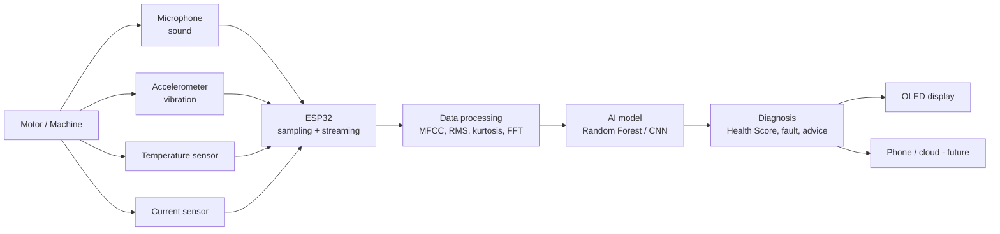

# MotorDoc X: Technical Design Document

## 1. Goal
Detect abnormal motor conditions early using low-cost sensors and AI/ML, and present the result in a form non-experts can understand.

## 2. System architecture



Plain-text version:

```
Machine -> Sensors -> ESP32 -> Data Processing -> AI Model -> Diagnosis -> OLED / Phone
```

## 3. Hardware design

| Component | Role | Interface | ESP32 pin (reference) |
|---|---|---|---|
| ESP32 DevKit | Controller, Wi-Fi/Bluetooth | - | - |
| Analog MEMS/electret mic module | Captures motor sound | ADC | GPIO 34 |
| MPU6050 accelerometer | Vibration | I2C | SDA 21, SCL 22 |
| DS18B20 | Surface temperature | 1-Wire | GPIO 4 |
| ACS712 (or similar) | Motor current | ADC | GPIO 35 |
| SSD1306 OLED | Real-time output | I2C | SDA 21, SCL 22 |

Notes: the current sensor must be rated and wired safely for the motor's supply. Mains-powered motors need a qualified person
for the current-sensing installation. Prefer a non-invasive clamp-type sensor for safety.

## 4. Software design

### 4.1 Feature extraction (`src/motordoc/features.py`)
- **Sound** (8 kHz, 1 s window): 13 mean MFCCs (Mel filterbank + log + DCT) and spectral centroid.
- **Vibration** (1 kHz, 1 s window): RMS (energy), kurtosis (impact/spikiness), dominant frequency (FFT).
- **Temperature** (deg C) and **current** (A): used directly.
- Output: one 19-value feature vector per 1-second reading.

### 4.2 Classifier (`src/motordoc/model.py`)
- Random Forest (200 trees) over the feature vector. Classes: `healthy`, `bearing_fault`, `imbalance`, `overload`.
- Chosen for small data sizes, fast inference, low compute and interpretability. A CNN on Mel spectrograms is planned for larger datasets.

### 4.3 Motor Health Score
```
score = 100 x (1 - sum over classes of P(class) x severity(class))
severity: healthy 0.00, imbalance 0.60, overload 0.70, bearing_fault 0.85
status:   GOOD >= 80, WARNING 50-79, CRITICAL < 50
```
The score uses class probabilities, so uncertain readings give intermediate scores instead of a hard pass/fail.
Severity weights are initial engineering choices and should be tuned with real data and expert input.

### 4.4 Recommendation engine
A lookup from the most likely condition to a plain-language action (for example, "Inspect/lubricate or replace bearing soon").

## 5. Data flow

1. ESP32 samples all sensors for about 1 s and sends a JSON reading over serial/Wi-Fi.
2. Python host (laptop / Raspberry Pi / phone backend) converts it to a feature vector.
3. Model returns probabilities, which become the health score, status, fault and advice.
4. Result is shown on the OLED and/or terminal.

Reading format: see `data/sample/sample_reading.json`.

## 6. Testing strategy

| Level | What | Where |
|---|---|---|
| Unit | MFCC shape, feature length, status thresholds | `tests/test_pipeline.py` |
| Functional | Model separates simulated fault classes; healthy scores higher than faulty | `tests/test_pipeline.py` |
| Field (planned) | Real pumps/motors, with and without background noise | `docs/DATA_COLLECTION.md` |

## 7. Limitations and risks
- Simulated data only so far; real-world accuracy is not yet measured.
- Background noise can degrade sound-based diagnosis. The multi-sensor design reduces reliance on sound alone.
- Different motors have different baselines. Per-machine calibration (a "healthy baseline" recording) is planned.

## 8. Future work
Mobile app and cloud monitoring, regional-language voice alerts, Remaining Useful Life prediction, maintenance history,
on-device (offline) inference, more machine types.
